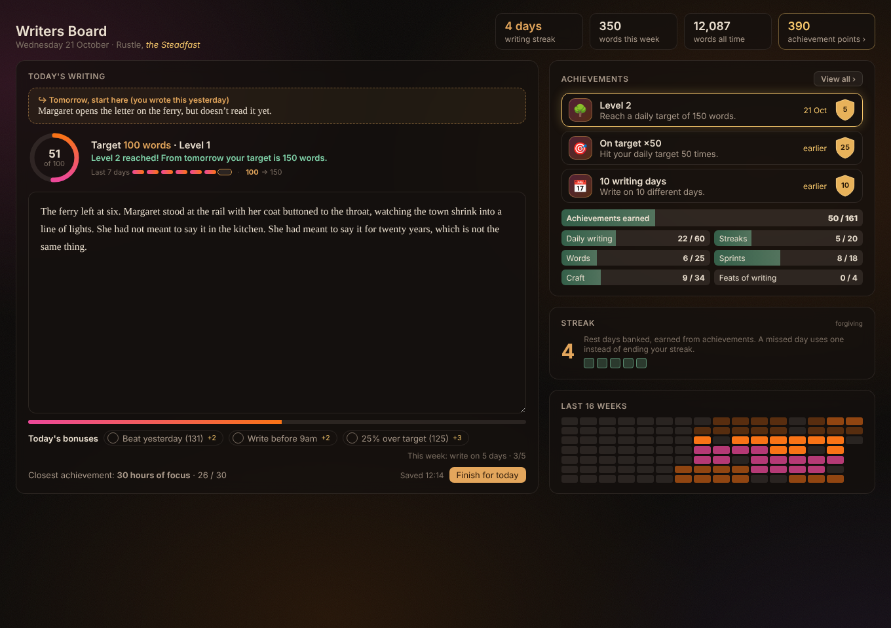
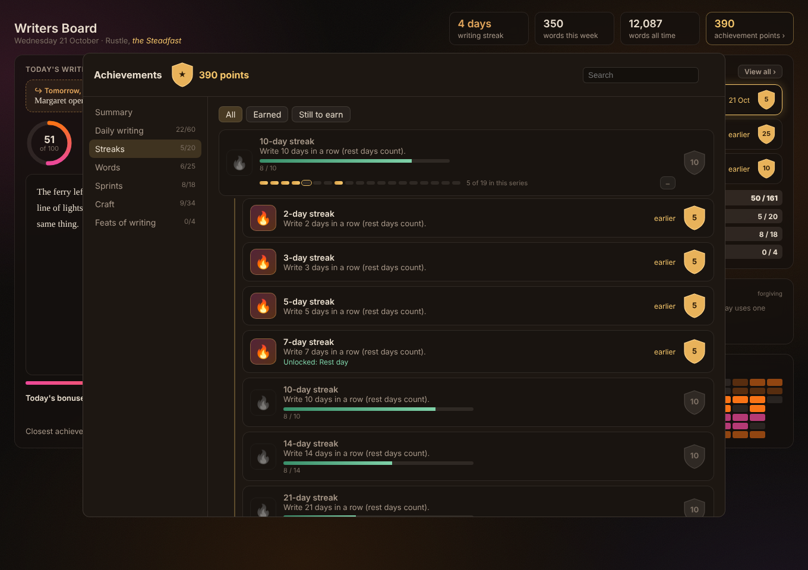
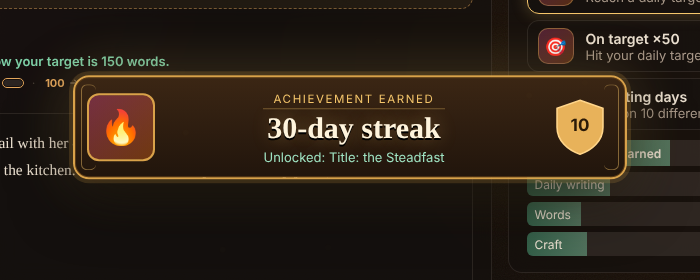

# Writers Board

A daily writing box with a target that grows as you do, a forgiving streak, and achievements that unlock real things: rest days, titles, ring colours and backgrounds.

## The writing box

Open the board from the ribbon (the pen icon) or the command **Writers Board: Open the board**, and just write. No prompt, no rules. What you write is saved into today's daily note under a `## Writing` heading, as plain Markdown.

- **A target that grows.** You start at 100 words a day. Hit your target on 5 of your last 7 writing days and it steps up by 50, up to a ceiling you choose. It never drops on its own. After a hard week it asks whether you'd like to stay where you are or ease back.
- **Finish for today.** Press it and today's writing is kept in your daily note and locked on the board, so you can't fiddle with it. Want to add more? **Write more** opens a fresh box under what you finished.
- **"Tomorrow, start here".** When you finish, leave yourself one line about where to pick up. It waits at the top of the board next time, so you never start from a blank page.
- **Daily bonuses.** Small extra goals each day (beat yesterday, write before 9am, go 25% over target) and a weekly one (write on 5 days).

## Achievements

Points, categories and series, with small steps early and bigger ones later. You get a banner when you hit your target or earn something, wherever you are in Obsidian (with a soft chime you can turn off).

- **Series** count up and never reset: words written, writing days, streaks, targets hit, words in a day, levels, Lantern sessions, hours of focus, early starts and more. Each series shows the next step, how far along you are, and **+** to see the whole series.
- **Feats of writing** are rare and give no points, only bragging rights.
- **They unlock things:**
  - **rest days**, which protect your streak;
  - **titles** shown on your board (*the Steadfast*, *Lamplighter*, *the Tireless*…);
  - **ring colours**;
  - **backgrounds**, such as Dusk and Northern lights.

When you first install it, Writers Board reads the writing already in your daily notes, so you start with the achievements you've already earned (quietly, without fifty banners).

## The streak, and rest days

Your streak counts the days in a row you've written. Rest days, earned from achievements, cover a missed day instead of ending your streak. You can bank up to five.

## Works with

- **[Lantern Focus](https://github.com/AshOtis/lantern-focus):** its "Focused 25 min" lines in your daily notes count as Lantern sessions and hours of focus, and while a session runs everything but Today's writing fades back (switch it off in settings).
- **[Static Aurora](https://github.com/AshOtis/aurora-theme):** choose the Static Aurora background and the board glows in the theme's live colours.
- **[Daily Board](https://github.com/AshOtis/Daily-Board)** and **[One Page](https://github.com/AshOtis/One-Page):** they read and write the same daily notes.

Everything works on its own; these just add to it.

## Settings

- **Daily notes:** uses the core Daily Notes settings by default (folder, date format, template), including subfolders such as an Archive (up to 3 deep).
- **What counts as writing:** the whole daily note (without headings, tasks and focus logs), or only the writing section.
- **Target:** starting target, step, ceiling, and the current target if you want to set it by hand.
- **Looks:** ring colour and background (unlocked ones), glow and darken.
- **Celebrations:** banners and sound, with a button to preview them.

## Privacy and network

Writers Board makes no network requests. It reads your daily notes folder (only that folder) and writes only to today's note, under the writing heading. Its own progress is kept in the plugin's `data.json` in your vault.

## Support

If it keeps you writing, you can [buy me a coffee](https://buymeacoffee.com/ashotis). Bugs and ideas: [issues](https://github.com/AshOtis/Writers-Board/issues).

[GNU AGPL v3 or later](LICENSE) © AshOtis
